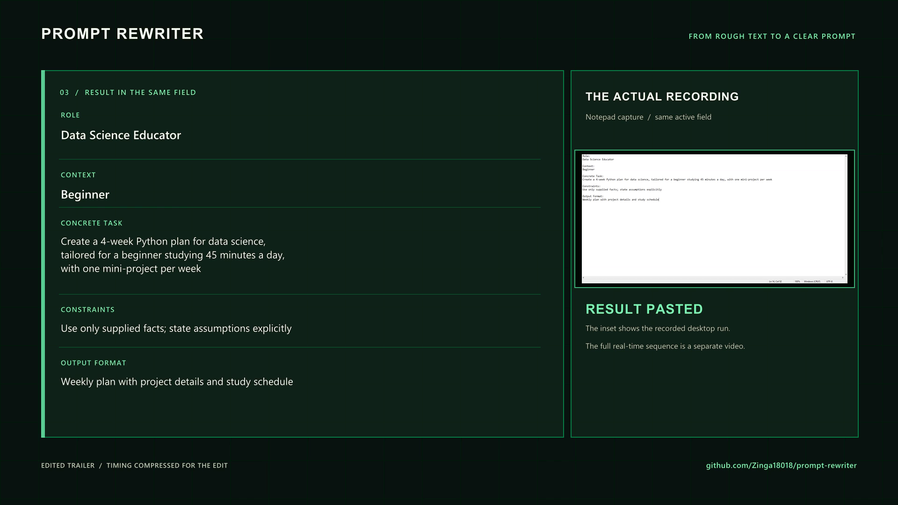

# Prompt Rewriter

[](https://github.com/Zinga18018/prompt-rewriter/actions/workflows/ci.yml)

Turn rough selected text into a structured, paste-ready AI prompt with one global hotkey.

Prompt Rewriter is a Windows-first Python desktop tool. Select text in an editable app, press
`Ctrl+Shift+Space`, and the tool replaces the selection with a prompt organized into **Role**,
**Context**, **Concrete Task**, **Constraints**, and **Output Format**.

> **Project status:** tested MVP for learning and portfolio use. It is not production-ready and
> should not be trusted with sensitive text or irreplaceable clipboard contents.

[](assets/prompt-rewriter-trailer.mp4)

**[Watch the cinematic trailer](assets/prompt-rewriter-trailer.mp4)** ·
**[Watch the continuous live demo](assets/prompt-rewriter-live-demo.mp4)**

Both videos use one recorded Notepad run with the local Ollama route. The trailer is edited for
pacing and adds visual labels; the live demo preserves the recorded wait from text selection to
replacement. Neither video is a universal latency or cross-application compatibility benchmark.
The rendering script uses a local source recording (`prompt-rewriter-capture-v2.mp4`) that is
intentionally excluded from Git; the finished videos above are included in this repository.

## What it does

1. Listens for a global `Ctrl+Shift+Space` hotkey.
2. Copies the currently selected text and rejects an empty or oversized selection.
3. Sends the text through the configured provider route:
   - Gemini Flash-Lite for low-latency cloud inference when explicitly enabled.
   - Groq for cloud inference when a key is configured.
   - Ollama for local inference or fallback.
4. Validates a strict five-field response before it can reach the clipboard.
5. Re-checks the focused control, recent user input, and clipboard state.
6. Replaces the selection and restores the previous plain-text clipboard value when safe.

Example input:

```text
make me a 4-week Python plan for data science; I am a beginner, can study 45 minutes a day,
and want one mini-project each week
```

Example structure returned by the local demo run:

```text
Role:
Data Science Educator

Context:
Beginner

Concrete Task:
Create a 4-week Python plan for data science, tailored for a beginner studying 45 minutes a day,
with one mini-project per week

Constraints:
Use only supplied facts; state assumptions explicitly

Output Format:
Weekly plan with project details and study schedule
```

Model wording can vary. The five headings and local validation rules do not.

## Why this is more than a shortcut script

The interesting part is the boundary between desktop automation and nondeterministic model output:

- The hotkey callback schedules work on one background worker, so the listener stays responsive and
  repeated triggers cannot overlap.
- All configured providers receive the same JSON schema. The app rejects missing or extra fields, duplicate
  keys, wrappers, filler, and malformed output, then renders the final text locally.
- Provider failures are bounded and isolated. The router attempts each configured provider once and
  returns a clean failure when none succeed.
- Paste is a guarded transaction, not a blind `Ctrl+V`: focus, input activity, and clipboard state
  are checked again after inference.
- `--doctor` and `--rewrite` separate provider problems from keyboard and clipboard problems.

## Architecture

```text
Ctrl+Shift+Space
       |
       v
single background worker
       |
       v
copy + selection validation
       |
       v
Gemini  ---- failure ---->  Groq  ---- failure ---->  Ollama
   |                         |                            |
   +-------------------------+----------- result --------+
                     |
                     v
strict five-field validation
                     |
                     v
focus + input + clipboard re-check
                     |
                     v
paste + best-effort text restoration
```

| Module | Responsibility |
| --- | --- |
| `config.py` | Environment parsing, defaults, limits, and provider order |
| `prompts.py` | Rewrite contract, JSON schema, validation, and final rendering |
| `providers/` | Gemini, Groq, and Ollama clients plus the fallback router |
| `windows_io.py` | Windows keyboard, clipboard, focus, and input checks |
| `workflow.py` | Guarded copy-infer-paste transaction |
| `daemon.py` | Global hotkey and serialized background execution |
| `diagnostics.py` | Read-only provider readiness checks |

## Quick start on Windows

Requirements:

- Windows 10 or 11
- Python 3.10 or newer
- An editable field where normal `Ctrl+C` and `Ctrl+V` work
- [Ollama for Windows](https://ollama.com/download/windows), a Gemini/Groq API key, or both

Open PowerShell in the repository:

```powershell
py -3.12 -m venv .venv
Set-ExecutionPolicy -Scope Process -ExecutionPolicy Bypass
.\.venv\Scripts\Activate.ps1
python -m pip install --upgrade pip
python -m pip install -e ".[dev]"
Copy-Item .env.example .env
```

The execution-policy change applies only to that PowerShell window and can be skipped if activation
already works. Keep `.env` private; it is intentionally excluded from Git.

### Local-only setup with Ollama

```powershell
winget install --exact --id Ollama.Ollama
ollama pull llama3.2:3b
```

Set the provider route in `.env`:

```dotenv
PROMPT_REWRITER_PROVIDER_ORDER=ollama
```

If the Ollama desktop app did not start the service, run `ollama serve` in a separate PowerShell
window. The app accepts only explicit loopback Ollama hosts such as `127.0.0.1` and ignores system
proxy settings for local calls.

The first local request may be slower while the model loads. Warm it without touching another app:

```powershell
python -m prompt_rewriter --doctor
python -m prompt_rewriter --rewrite "make a four week Python learning plan"
```

### Optional Groq cloud route

Add a Groq key to `.env`:

```dotenv
PROMPT_REWRITER_PROVIDER_ORDER=groq,ollama
GROQ_API_KEY=
GROQ_MODEL=openai/gpt-oss-20b
```

Provider availability changes over time, so confirm model access in the
[Groq model documentation](https://console.groq.com/docs/models). When Groq is first in the route,
selected text is sent to Groq. Use `PROMPT_REWRITER_PROVIDER_ORDER=ollama` when text must stay on the
local machine.

### Optional Gemini cloud route

First, create a new private key in Google AI Studio. If a key has appeared in a chat, log, commit,
or screenshot, revoke it and create another one before continuing. Put only the replacement key in
the ignored local `.env` file:

```dotenv
PROMPT_REWRITER_PROVIDER_ORDER=gemini,ollama
GEMINI_API_KEY=
GEMINI_MODEL=gemini-3.5-flash-lite
```

The Gemini request uses the API-key header rather than putting the credential in the URL. It uses
the current Interactions API with storage explicitly disabled. The default model is the stable
Flash-Lite model selected for low-latency structured rewriting. When Gemini fails or times out, the
existing router tries Ollama once. Selected text leaves the computer whenever Gemini is first in
the configured route.

### Run the hotkey listener

```powershell
python -m prompt_rewriter
```

Then:

1. Open Notepad and type a rough request.
2. Select exactly that text.
3. Press `Ctrl+Shift+Space` once.
4. Leave the same field focused until the rewrite finishes.
5. Press `Ctrl+C` in PowerShell to stop the listener.

Start with Notepad before trying an IDE, browser, or Electron app. Some applications remap keyboard
shortcuts or intentionally block synthetic input.

## Configuration

The annotated defaults live in [`.env.example`](.env.example). The most useful controls are:

| Setting | Purpose |
| --- | --- |
| `PROMPT_REWRITER_PROVIDER_ORDER` | Comma-separated fallback order using `gemini`, `groq`, and/or `ollama` |
| `PROMPT_REWRITER_HOTKEY` | Global trigger; defaults to `ctrl+shift+space` |
| `PROMPT_REWRITER_MAX_INPUT_CHARS` | Rejects unexpectedly large selections before inference |
| `PROMPT_REWRITER_COPY_TIMEOUT_SECONDS` | Maximum clipboard-copy wait before the UIA fallback (default `0.35`) |
| `PROMPT_REWRITER_RESTORE_CLIPBOARD` | Restores the prior plain-text value after a successful paste when safe |
| `GEMINI_TIMEOUT_SECONDS` | Gemini request time limit before fallback |
| `GROQ_TIMEOUT_SECONDS` | Cloud request time limit before fallback |
| `OLLAMA_TIMEOUT_SECONDS` | Local request time limit |
| `OLLAMA_KEEP_ALIVE` | How long Ollama keeps the model loaded |

PowerShell environment variables override `.env` for the current process:

```powershell
$env:PROMPT_REWRITER_LOG_LEVEL = "DEBUG"
python -m prompt_rewriter --doctor
```

## Safety and privacy boundaries

- **Cloud routing sends selected text off-device.** Never select passwords, API keys, protected
  health information, confidential client data, or other sensitive material when Gemini or Groq
  is enabled.
- **Clipboard recovery is plain-text and best effort.** Rich formats such as images, files, HTML,
  or application-specific objects are not preserved. The app refuses to start the transaction when
  the clipboard contains only non-text data.
- **Desktop state can race.** Clipboard managers, sync tools, accessibility software, notifications,
  and another application can change focus or clipboard contents between checks.
- **Synthetic input has OS boundaries.** Password fields, elevated apps, Windows secure desktop,
  remote sessions, games, and endpoint-security tools may block the workflow.
- **Model output is not automatically correct.** Structural validation prevents malformed output;
  it does not prove factual accuracy, completeness, or suitability for a high-stakes task.

Run Prompt Rewriter at the same privilege level as the target app. Prefer running both normally;
elevation gives the tool more access and still cannot automate Windows secure desktop.

See [SECURITY.md](SECURITY.md) for the threat boundary and responsible reporting guidance.

## Verified status

Current workspace verification on **September 30, 2026**:

- The automated test suite passes locally.
- `python -m pip check` reported no broken requirements.
- A local Ollama rewrite and a full Notepad copy-rewrite-paste flow completed successfully for the
  recorded demo.
- The Gemini adapter, schema, routing, error sanitization, and diagnostics are verified with mocked
  API responses. No live Gemini request was made with the exposed credential; live verification
  remains pending until a newly rotated key is configured locally.

The automated suite uses controlled fakes for provider and desktop edge cases. One successful
Notepad run does not prove compatibility with every Windows application.

Run the checks yourself:

```powershell
python -m pytest
python -m ruff check .
python -m pip check
```

## Known limitations

- Global-hotkey mode is Windows-only.
- Clipboard restoration does not preserve every native clipboard format.
- The tool cannot perfectly identify selection semantics in every app; some editors copy the whole
  line when nothing is highlighted.
- Local inference is not zero-latency, and cloud inference is affected by network and service state.
- There is no tray UI, signed installer, automatic startup, application allowlist, or packaged
  release yet.
- Safety checks reduce common paste races but cannot make cross-application automation atomic.

## Roadmap

- Native multi-format Windows clipboard snapshots and restoration.
- Tray controls for pause/resume, provider visibility, and shortcut editing.
- Per-application allow/deny rules and clearer non-sensitive status notifications.
- Warm/cold p50 and p95 benchmarks on named hardware instead of one-off latency claims.
- Application-level UI tests, signed packaging, and release documentation.

For follow-on portfolio builds that reuse this architecture, see
[PROJECT_IDEAS.md](PROJECT_IDEAS.md).

## Troubleshooting

**No usable provider:** run `python -m prompt_rewriter --doctor`. For Ollama, confirm
`ollama list` contains the configured model. For Gemini or Groq, confirm the replacement private
key and configured model are available to the account.

**The hotkey does nothing:** verify `--rewrite` first, then test a clearly highlighted selection in
Notepad. Check for a shortcut conflict and keep the tool at the same privilege level as the target.

**Paste is cancelled:** keep the original field focused and avoid typing, clicking, or changing the
clipboard during inference. A cancellation is usually a safety check doing its job.

**The first Ollama rewrite is slow:** that normally includes model-load time. Keep the model warm
with `OLLAMA_KEEP_ALIVE` and choose a model that fits available RAM.

## Scope and license

This repository is a compact, inspectable systems-and-AI engineering MVP—not a promise of safe
production deployment. No open-source license has been selected yet.
